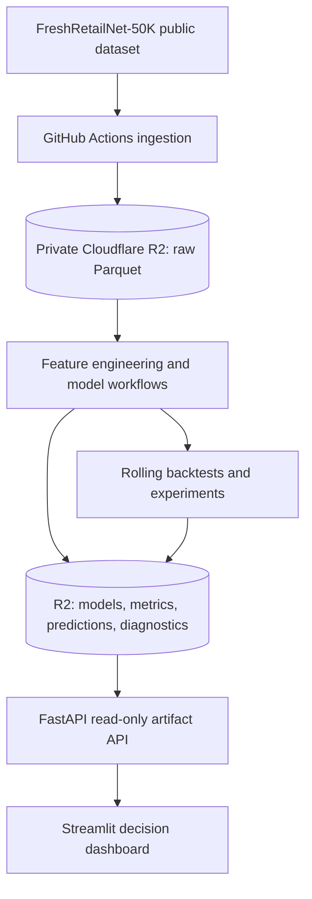

# FreshRetailNet Demand Intelligence

A reproducible demand-forecasting and inventory decision-support project built on the FreshRetailNet-50K dataset. The repository combines data ingestion, leakage-aware feature engineering, LightGBM point and quantile forecasts, stockout diagnostics, inventory-policy simulation, a read-only FastAPI service, and a Streamlit dashboard.

> **Important target definition:** the supervised target is observed daily sales (`sale_amount`). It is not necessarily unconstrained customer demand: sales may be censored when products are unavailable. Stockout analyses are descriptive unless a separately validated lost-sales reconstruction is introduced.

## What the system does

- Ingests the public dataset and stores raw Parquet files in a private Cloudflare R2 bucket.
- Builds daily calendar, lagged-sales, lagged-stock-status, and rolling-history features.
- Trains a LightGBM point model and P10/P50/P90 quantile models.
- Evaluates against a seasonal-naive lag-7 benchmark.
- Produces split-conformal interval adjustments using a prior validation period.
- Profiles stockout exposure and observed-sales patterns.
- Simulates order-up-to inventory policies under explicit cost and lead-time assumptions.
- Publishes artifacts to R2 for consumption by FastAPI and Streamlit.
- Includes experimental wavelet, demand-segmentation, and rolling-backtest workflows.

## Architecture



## Repository map

| Path | Responsibility |
|---|---|
| `scripts/ingest_freshretailnet_to_r2.py` | Download, checksum-verify, and upload source Parquet |
| `scripts/profile_and_process_r2.py` | Profile and re-encode R2 data |
| `scripts/stockout_diagnostics.py` | Stockout-exposure diagnostics |
| `scripts/sql_eda.py` | DuckDB SQL exploratory analysis |
| `src/train_model.py` | Point-forecast feature engineering and LightGBM training |
| `src/train_quantile_models.py` | P10/P50/P90 forecasting and conformal interval adjustment |
| `src/simulate_inventory.py` | Inventory policy simulation from held-out forecast rows |
| `experiments/demand_intelligence/` | Demand segmentation and multi-window challenger experiments |
| `experiments/wavelet/` | Wavelet feature experiments and comparisons |
| `api/main.py` | Read-only FastAPI artifact endpoints |
| `dashboard/app.py` | Streamlit dashboard |
| `docs/` | Ingestion, R2 processing, and deployment instructions |
| `tests/` | Offline regression and data-contract tests |
| `.github/workflows/` | Reproducible ingestion, modelling, experiment, and quality workflows |

## Data and reproducibility

**Dataset:** [Dingdong-Inc/FreshRetailNet-50K](https://huggingface.co/datasets/Dingdong-Inc/FreshRetailNet-50K). The ingestion documentation records the source files, CC BY 4.0 attribution requirement, checksum verification, and expected R2 object keys. Raw data is not committed to Git.

### Required R2 objects

```text
raw/train.parquet
raw/eval.parquet
```

Create a private R2 bucket and configure the GitHub Actions secrets documented in [docs/DATA_INGESTION.md](docs/DATA_INGESTION.md). Run the ingestion workflow before model or diagnostic workflows. See [docs/R2_PROCESSING.md](docs/R2_PROCESSING.md) for the processing workflow.

### Chronological split policy

The training scripts build lagged features on combined chronological train and evaluation history so that the evaluation period can use preceding training observations as context. They then:
1. Reserve the latest 14 distinct dates within the training partition as the model-selection/early-stopping validation window.
2. Fit on earlier eligible training dates.
3. Evaluate on the dataset's separate evaluation partition.

The current point and quantile pipelines are **one-day-ahead daily observed-sales forecasts**. The demand-intelligence experiment suite separately evaluates 1-, 7-, and 14-calendar-day horizons using chronological rolling windows. Do not interpret those experiment horizons as the production model's output horizon.

Feature construction shifts sales and stock-status summaries before computing lags and rolling statistics. Contemporaneous hourly sales and current-day stock observations are excluded from model predictors. The quantile pipeline uses current-day stock exposure only for post-hoc evaluation stratification, not as a predictor. See the source scripts for the exact feature lists and metric definitions.

### Target and censoring limitations

- `sale_amount` is observed sales, not confirmed latent demand.
- Stockouts can suppress observed sales; a low observed value during an out-of-stock period should not automatically be interpreted as low demand.
- Stockout-bucket summaries are descriptive associations, not causal lost-sales estimates.
- The technical meaning of stock-status encodings should be checked against the dataset documentation before interpreting them directionally.
- Inventory simulation uses observed sales as a demand proxy and is conditional on configurable initial stock, lead time, review cadence, holding cost, shortage penalty, and order cost.

## Evaluation methodology

The point model is compared with the seasonal-naive lag-7 prediction. Reported metrics include:
- **MAE:** mean absolute error, in observed-sales units.
- **RMSE:** root mean squared error, in observed-sales units.
- **WAPE:** aggregate absolute error divided by aggregate absolute observed sales.
- **Bias:** signed aggregate forecast error relative to aggregate observed sales.

Quantile forecasts are evaluated with pinball loss, P10–P90 coverage, interval width, median MAE/WAPE, and quantile-crossing rate. The conformal adjustment is estimated on the prior validation period; temporal distribution shift can invalidate nominal future coverage.

Rolling challenger experiments report fold-level and pooled metrics. The latest segment rolling-backtest workflow also estimates paired store-product cluster bootstrap intervals. Those intervals quantify cross-sectional cluster uncertainty, not all uncertainty due to future time-window shifts. Always inspect fold consistency and retain a later untouched period for final confirmation.

### Results reporting

Results are intentionally not hard-coded here: metrics are generated from the actual R2-backed workflow runs and can change when data, code, or evaluation windows change. Use the JSON/CSV artifacts below as the source of truth and record the run URL, commit SHA, date range, sample size, and split when publishing a result.

| Experiment | Primary comparison | Artifact location |
|---|---|---|
| Point forecast | LightGBM vs seasonal-naive lag-7 | `model-artifacts/metrics.json` |
| Quantile forecast | P10/P50/P90, pinball loss, interval coverage | `quantile-model-artifacts/quantile_metrics.json` |
| Wavelet experiments | Baseline vs wavelet feature families | `wavelet-experiment-artifacts/` and experiment-specific prefixes |
| Demand segmentation | Segment and horizon comparisons | `demand-segmentation-multihorizon-artifacts/` |
| Rolling segment specialists | Production LightGBM vs validation-gated and calibrated specialists | `segment-rolling-backtest-artifacts/segment_rolling_backtest_report.json` |
| Inventory simulation | Policy fill rate and simulated costs | `inventory-simulation-artifacts/inventory_simulation_summary.json` |

Do not report a challenger as better based only on a single pooled metric. Include the number of test rows, number and date range of folds, segment sample sizes, uncertainty intervals, and trade-offs such as forecast bias.

## Run locally

The raw Parquet files are stored in private R2 and are not included in this repository. A fully data-backed local run therefore requires access to the same raw objects or equivalent source files. There is no bundled sample dataset at present.

### API

```bash
cd api
python -m pip install -r requirements.txt
export R2_ACCOUNT_ID="..."
export R2_ACCESS_KEY_ID="..."
export R2_SECRET_ACCESS_KEY="..."
export R2_BUCKET="..."
uvicorn main:app --reload
```

Open `http://localhost:8000/docs`. The API is read-only and returns HTTP 503 when a required R2 artifact is unavailable or cannot be read.

### Dashboard

In a second terminal:

```bash
cd dashboard
python -m pip install -r requirements.txt
export API_BASE_URL="http://localhost:8000"
streamlit run app.py
```

### Tests

From the repository root:

```bash
python -m pip install -r api/requirements.txt -r dashboard/requirements.txt pytest
pytest -q
python -m compileall -q api dashboard src scripts experiments tests
```

The tests are offline and do not require R2 credentials. Full data/model workflows require the configured R2 secrets and source objects.

## Deployment

- **FastAPI:** use the root [render.yaml](render.yaml) Blueprint. Configure the four R2 environment variables in Render.
- **Streamlit:** deploy `dashboard/app.py` and set `API_BASE_URL` to the deployed API URL.
- Keep R2 credentials on the API/Actions side only. Never expose them to the browser, Streamlit client, or Git history.
- Render's free service can sleep when idle; expect cold-start latency.

Detailed steps: [docs/APP_DEPLOYMENT.md](docs/APP_DEPLOYMENT.md).

## Current limitations and next validation steps

1. Validate the models on a later untouched period before production promotion.
2. Investigate stockout-censored demand with a documented and validated reconstruction strategy; do not treat descriptive stockout differences as lost sales.
3. Monitor quantile coverage by time and stockout-exposure segment; current documentation notes evaluation coverage below the nominal 80% target.
4. Confirm that any target-date calendar fields used in experiments are operationally available at forecast time.
5. Validate inventory policies under multiple lead times, review periods, cost scenarios, and realistic replenishment constraints.
6. Keep experiment artifacts versioned with commit SHA, data snapshot, evaluation dates, and configuration.

## License and attribution

The source dataset is distributed under CC BY 4.0; retain attribution to the dataset authors and review the dataset card's terms when redistributing derived data. This repository's own code license should be specified by the repository owner before external reuse.


## Reproducible small-data demo

Run the synthetic inventory demo without R2 credentials or the full dataset:

```bash
pip install -r api/requirements.txt
python scripts/run_small_demo.py --output-dir demo_output
```

It writes a synthetic forecast CSV, policy simulation CSV and JSON summary. These
fixtures demonstrate execution and accounting only; they are not benchmark data.
See [the demo guide](docs/SMALL_DATA_DEMO.md).

## Experiment uncertainty and sample sizes

The multi-window segment rolling backtest publishes:
- `segment_rolling_backtest_comparison.csv`: paired baseline/challenger metrics,
  95% cluster-bootstrap intervals, evaluation row counts, store-product clusters,
  test folds and bootstrap replicate counts.
- `segment_rolling_backtest_comparison.md`: readable comparison report.
- `segment_rolling_backtest_report.json`: full fold audits, selection diagnostics,
  sample-size summary and bootstrap methodology.

Intervals quantify cross-sectional cluster uncertainty, not future temporal
window uncertainty. See [artifact failure and recovery behaviour](docs/ARTIFACT_FAILURE_HANDLING.md).

## Quality checks

GitHub Actions compiles the Python modules, runs offline API/artifact and inventory
forecasting tests, and runs Ruff static checks. The checks monkeypatch R2 access;
they do not require production credentials or assert that remote artifacts exist.
