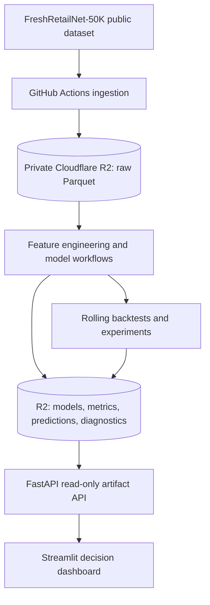

# FreshRetailNet Demand Intelligence

A reproducible demand-forecasting and inventory decision-support project built on the FreshRetailNet-50K dataset. The repository combines data ingestion, leakage-aware feature engineering, LightGBM point and quantile forecasts, stockout diagnostics, inventory-policy simulation, a read-only FastAPI service, and a Streamlit dashboard.

> **Important target definition:** the supervised target is observed daily sales (`sale_amount`). It is not necessarily unconstrained customer demand: sales may be censored when products are unavailable. Stockout analyses are descriptive unless a separately validated lost-sales reconstruction is introduced.

## What the system does

- Ingests the public dataset and stores raw Parquet files in a private Cloudflare R2 bucket.
- Builds daily calendar, lagged-sales, lagged-stock-status, and rolling-history features.
- Trains a LightGBM point model and P10/P50/P90 quantile models.
- Evaluates against a seasonal-naive lag-7 benchmark.
- Produces split-conformal interval adjustments using a prior validation period.
- Profiles stockout exposure and observed-sales patterns.
- Simulates order-up-to inventory policies under explicit cost and lead-time assumptions.
- Publishes artifacts to R2 for consumption by FastAPI and Streamlit.
- Includes experimental wavelet, demand-segmentation, and rolling-backtest workflows.

## Architecture



## Repository map

| Path | Responsibility |
|---|---|
| `scripts/ingest_freshretailnet_to_r2.py` | Download, checksum-verify, and upload source Parquet |
| `scripts/profile_and_process_r2.py` | Profile and re-encode R2 data |
| `scripts/stockout_diagnostics.py` | Stockout-exposure diagnostics |
| `scripts/sql_eda.py` | DuckDB SQL exploratory analysis |
| `scripts/full_dataset_eda.py` | Complete EDA across all 19 original source fields and both splits |
| `scripts/optimize_inventory.py` | Store-level stochastic inventory allocation with service and capacity constraints |
| `experiments/time_series/research_benchmark.py` | STL/Fourier/spectral/wavelet research, residual correction and validation-selected ensemble |
| `src/train_model.py` | Point-forecast feature engineering and LightGBM training |
| `src/train_quantile_models.py` | P10/P50/P90 forecasting and conformal interval adjustment |
| `src/simulate_inventory.py` | Inventory policy simulation from held-out forecast rows |
| `experiments/demand_intelligence/` | Demand segmentation and multi-window challenger experiments |
| `experiments/wavelet/` | Wavelet feature experiments and comparisons |
| `experiments/time_series/` | Advanced time-series research benchmark and model selection |
| `api/main.py` | Read-only FastAPI artifact endpoints |
| `dashboard/app.py` | Streamlit dashboard |
| `docs/` | Ingestion, R2 processing, and deployment instructions |
| `tests/` | Offline regression and data-contract tests |
| `.github/workflows/` | Reproducible ingestion, modelling, experiment, and quality workflows |

## Data and reproducibility

**Dataset:** [Dingdong-Inc/FreshRetailNet-50K](https://huggingface.co/datasets/Dingdong-Inc/FreshRetailNet-50K). The ingestion documentation records the source files, CC BY 4.0 attribution requirement, checksum verification, and expected R2 object keys. Raw data is not committed to Git.

### Required R2 objects

```text
raw/train.parquet
raw/eval.parquet
```

Create a private R2 bucket and configure the GitHub Actions secrets documented in [docs/DATA_INGESTION.md](docs/DATA_INGESTION.md). Run the ingestion workflow before model or diagnostic workflows. See [docs/R2_PROCESSING.md](docs/R2_PROCESSING.md) for the processing workflow.

### Chronological split policy

The training scripts build lagged features on combined chronological train and evaluation history so that the evaluation period can use preceding training observations as context. They then:
1. Reserve the latest 14 distinct dates within the training partition as the model-selection/early-stopping validation window.
2. Fit on earlier eligible training dates.
3. Evaluate on the dataset's separate evaluation partition.

The current point and quantile pipelines are **one-day-ahead daily observed-sales forecasts**. The demand-intelligence experiment suite separately evaluates 1-, 7-, and 14-calendar-day horizons using chronological rolling windows. Do not interpret those experiment horizons as the production model's output horizon.

Feature construction shifts sales and stock-status summaries before computing lags and rolling statistics. Contemporaneous hourly sales and current-day stock observations are excluded from model predictors. The quantile pipeline uses current-day stock exposure only for post-hoc evaluation stratification, not as a predictor. See the source scripts for the exact feature lists and metric definitions.

### Target and censoring limitations

- `sale_amount` is observed sales, not confirmed latent demand.
- Stockouts can suppress observed sales; a low observed value during an out-of-stock period should not automatically be interpreted as low demand.
- Stockout-bucket summaries are descriptive associations, not causal lost-sales estimates.
- The technical meaning of stock-status encodings should be checked against the dataset documentation before interpreting them directionally.
- Inventory simulation uses observed sales as a demand proxy and is conditional on configurable initial stock, lead time, review cadence, holding cost, shortage penalty, and order cost.

## Full original-dataset exploration

The **Dataset explorer** dashboard tab is backed by a separate R2 report produced by
`scripts/full_dataset_eda.py`. It profiles the original FreshRetailNet-50K train and
evaluation Parquet files together, while retaining split-level row counts and date
coverage. The report validates the expected 19-column source schema before publishing.

The feature explorer covers all original fields: city/store identifiers; management,
first-, second- and third-level product categories; product identifier; date; normalized
daily sales; 24-position hourly sales; operating-hour stockout count; 24-position hourly
stock status; discount factor; holiday and activity flags; precipitation; temperature;
humidity; and wind level. It includes per-field null/distinct counts, numeric summaries
and histograms, categorical frequency tables, vector-length checks, hourly profiles,
daily trends, calendar/discount/stockout breakdowns, hierarchy summaries and numeric
correlations.

Run **FreshRetailNet SQL and full dataset EDA** from GitHub Actions after ingestion to
publish `dataset-eda/full_dataset_eda.json` to private R2. The dashboard reads this
artifact through `/api/v1/dataset-eda`. Until the workflow publishes it, the EDA tab
shows an actionable availability message. These views are descriptive: normalized
observed sales can be censored by stockouts, and correlations or group differences
are not causal effects.

The Forecast explorer and Experiment lab use searchable Store and Product dropdowns.
The Product options are dependent on the selected Store and are retrieved through
the API rather than rendering a 50,000-item list in the browser.

## Evaluation methodology

The point model is compared with the seasonal-naive lag-7 prediction. Reported metrics include:
- **MAE:** mean absolute error, in observed-sales units.
- **RMSE:** root mean squared error, in observed-sales units.
- **WAPE:** aggregate absolute error divided by aggregate absolute observed sales.
- **Bias:** signed aggregate forecast error relative to aggregate observed sales.

Quantile forecasts are evaluated with pinball loss, P10–P90 coverage, interval width, median MAE/WAPE, and quantile-crossing rate. The conformal adjustment is estimated on the prior validation period; temporal distribution shift can invalidate nominal future coverage.

Rolling challenger experiments report fold-level and pooled metrics. The latest segment rolling-backtest workflow also estimates paired store-product cluster bootstrap intervals. Those intervals quantify cross-sectional cluster uncertainty, not all uncertainty due to future time-window shifts. Always inspect fold consistency and retain a later untouched period for final confirmation.

### Public benchmark results

The following reports publish aggregate results from successful R2-backed workflow runs. Raw predictions, model files and series-level artifacts remain in private R2.

| Report | What it answers |
|---|---|
| [Point forecast benchmark](docs/results/forecast_benchmark.md) | LightGBM vs seasonal-naive lag-7, error metrics, bias, dates and row counts |
| [Quantile evaluation](docs/results/quantile_evaluation.md) | P10/P50/P90 pinball loss, raw and calibrated coverage, interval width and stockout-exposure strata |
| [Conditional interval calibration](docs/results/conditional_interval_calibration.md) | Prior-exposure conformal candidate; documents why the 16+ hour coverage gap remains unresolved |
| [Inventory backtest](docs/results/inventory_backtest.md) | Fill-rate vs simulated-cost trade-offs for seasonal naive, P50 and calibrated P90 policies |
| [Inventory scenario backtest](docs/results/inventory_scenario_backtest.md) | Lead time, review cadence, storage/MOQ/pack constraints and shortage-cost sensitivity |
| [Segment rolling backtest](docs/results/segment_rolling_backtest.md) | 1-, 7- and 14-day challenger results, calibration and temporal-fold caveats |
| [Consolidated experiment summary](docs/results/experiment_summary.csv) | Machine-readable summary of the published comparisons |

**Headline point-model result:** on the 350,000-row evaluation partition from 2024-06-26 to 2024-07-02, LightGBM achieved MAE 0.38682 versus 0.49907 for seasonal naive (22.49% lower), RMSE 0.67889 versus 0.83582, and WAPE 32.42% versus 41.83%. LightGBM bias was -5.40%, so the accuracy gain comes with an under-forecasting trade-off.

**Uncertainty warning:** the conformal P10–P90 interval achieved 77.46% coverage on the held-out evaluation period versus an 80% nominal target. Validation coverage was 80.00%; do not claim nominal future coverage.

**Inventory trade-off:** calibrated P90 achieved an 85.61% full-horizon observed-sales fill rate versus 78.15% for seasonal naive, but its simulated total cost was 1,126,397 versus 1,119,545 under the illustrative cost assumptions. This is a simulated policy comparison, not measured business savings.

### Latest five-fold segment-specialist experiment

The successful [five-fold run #46124737202](https://github.com/Harshithpatali/freshretailnet-demand-intelligence/actions/runs/46124737202) evaluates 1-, 7- and 14-day horizons over 5 chronological folds, 50,000 store-product clusters and 2.75 million held-out rows.

| Horizon | Calibrated MAE | MAE improvement | 95% paired cluster-bootstrap CI |
|---|---:|---:|---:|
| 1 day | 0.39276 | +0.053% | -0.014% to +0.112% |
| 7 days | 0.41991 | +1.565% | +1.453% to +1.673% |
| 14 days | 0.45244 | +1.443% | +1.318% to +1.561% |

H7/H14 also improve pooled RMSE and WAPE with 95% cluster-bootstrap intervals excluding zero. H1 is inconclusive on MAE, and calibrated RMSE worsens by 0.399%. Keep the baseline at H1 and treat H7/H14 as challengers pending a later untouched time window. These intervals measure cross-sectional store-product uncertainty conditional on the five windows, not future temporal uncertainty. See the [full five-fold report](docs/results/segment_rolling_backtest.md) and [expanded experiment summary](docs/results/experiment_summary.csv).

Each report identifies its workflow run, evaluation period, sample size and limitations. Re-run the workflows after changing data or code and publish a new dated report rather than silently replacing historical results. Do not compare the separate multi-horizon segment experiments with the production one-day-ahead model as if they were the same task.

## Advanced research: constrained inventory and time-series benchmark

The repository includes two additional reproducible research tracks:

- **Stochastic inventory optimization:** a mixed-integer, store-level allocation model selects one order-up-to quantity per SKU while enforcing a demand-weighted expected fill-rate target and shared store capacity. It also applies MOQ, pack-size and maximum-order assumptions. A heavily penalized slack variable reports service targets that cannot be met under a given capacity. See [the mathematical formulation and limitations](docs/STOCHASTIC_INVENTORY_OPTIMIZATION.md).
- **Advanced time-series research:** compares the existing LightGBM feature baseline with Fourier harmonics, causal STL features, FFT spectral diagnostics and trailing db2 wavelet features. It includes a same-row wavelet ablation, a residual correction model trained on an earlier validation block, and non-negative ensemble weights selected on a later validation block. See [the benchmark methodology](docs/TIME_SERIES_RESEARCH_BENCHMARK.md).

The inventory workflow evaluates 27 combinations of lead/review cycle, service target and shared capacity. The time-series workflow uses a deterministic 1,500-series research cohort to bound repeated STL fits. Its model selection and residual fitting use validation only; the existing seven-day evaluation partition is scored after those decisions are frozen.

Artifacts are published to private R2 under `inventory-optimization-artifacts/` and `timeseries-research-artifacts/`. The dashboard exposes **Optimized inventory engine** and **Time-series research benchmark** pages. Run the respective GitHub Actions workflows after merge to refresh those reports.

**Important modelling assumptions:** the inventory optimizer approximates protection-period demand as Normal and combines daily forecast variances under an independence assumption. Capacity, costs, MOQ and pack sizes are illustrative values in normalized observed-sales units. The time-series research cohort is a sample, not the full 50,000-series population. Both tracks use observed sales, which may be stockout-censored. Neither result should be described as measured retailer savings or proven future performance.

## Run locally

The raw Parquet files are stored in private R2 and are not included in this repository. A fully data-backed local run therefore requires access to the same raw objects or equivalent source files. There is no bundled sample dataset at present.

### API

```bash
cd api
python -m pip install -r requirements.txt
export R2_ACCOUNT_ID="..."
export R2_ACCESS_KEY_ID="..."
export R2_SECRET_ACCESS_KEY="..."
export R2_BUCKET="..."
uvicorn main:app --reload
```

Open `http://localhost:8000/docs`. The API is read-only and returns HTTP 503 when a required R2 artifact is unavailable or cannot be read.

### Dashboard

In a second terminal:

```bash
cd dashboard
python -m pip install -r requirements.txt
export API_BASE_URL="http://localhost:8000"
streamlit run app.py
```

### Tests

From the repository root:

```bash
python -m pip install -r api/requirements.txt -r dashboard/requirements.txt pytest
pytest -q
python -m compileall -q api dashboard src scripts experiments tests
```

The tests are offline and do not require R2 credentials. Full data/model workflows require the configured R2 secrets and source objects.

## Deployment

- **FastAPI:** use the root [render.yaml](render.yaml) Blueprint. Configure the four R2 environment variables in Render.
- **Streamlit:** deploy `dashboard/app.py` and set `API_BASE_URL` to the deployed API URL.
- Keep R2 credentials on the API/Actions side only. Never expose them to the browser, Streamlit client, or Git history.
- Render's free service can sleep when idle; expect cold-start latency.

Detailed steps: [docs/APP_DEPLOYMENT.md](docs/APP_DEPLOYMENT.md).

## Current limitations and next validation steps

1. Validate the models on a later untouched period before production promotion.
2. Investigate stockout-censored demand with a documented and validated reconstruction strategy; do not treat descriptive stockout differences as lost sales.
3. Monitor quantile coverage by time and stockout-exposure segment; current documentation notes evaluation coverage below the nominal 80% target.
4. Confirm that any target-date calendar fields used in experiments are operationally available at forecast time.
5. Validate inventory policies under multiple lead times, review periods, cost scenarios, and realistic replenishment constraints.
6. Keep experiment artifacts versioned with commit SHA, data snapshot, evaluation dates, and configuration.

## License and attribution

The source dataset is distributed under CC BY 4.0; retain attribution to the dataset authors and review the dataset card's terms when redistributing derived data. This repository's own code license should be specified by the repository owner before external reuse.


## Reproducible small-data demo

Run the synthetic inventory demo without R2 credentials or the full dataset:

```bash
pip install -r api/requirements.txt
python scripts/run_small_demo.py --output-dir demo_output
```

It writes a synthetic forecast CSV, policy simulation CSV and JSON summary. These
fixtures demonstrate execution and accounting only; they are not benchmark data.
See [the demo guide](docs/SMALL_DATA_DEMO.md).

## Experiment uncertainty and sample sizes

The multi-window segment rolling backtest publishes fold-level predictions and
point estimates first. A separate post-hoc cluster-bootstrap step then reuses
those predictions (without retraining) to publish paired 95% intervals,
evaluation row counts, store-product clusters, test folds and replicate counts.
Intervals quantify cross-sectional cluster uncertainty, not future temporal
window uncertainty. See [extended validation and monitoring](docs/VALIDATION_AND_MONITORING.md)
and [artifact failure and recovery behaviour](docs/ARTIFACT_FAILURE_HANDLING.md).

## Quality checks

GitHub Actions compiles the Python modules, runs offline API/artifact and inventory
forecasting tests, and runs Ruff static checks. The checks monkeypatch R2 access;
they do not require production credentials or assert that remote artifacts exist.


- [FreshRetailNet-LT external temporal validation](docs/FRESHRETAILNET_LT_VALIDATION.md) — separate later-dated population, pinned ingestion and 70-day rolling/inventory evaluation.

## Later untouched evaluation gate

The released benchmark evaluation ends on 2024-07-02. The project includes a fail-closed gate for a separate `raw/later_holdout.parquet` snapshot with at least 14 strictly later, contiguous dates and at least 95% of the benchmark store-product population. The gate validates readiness only; frozen model scoring is a separate subsequent step. See [later holdout requirements and procedure](docs/LATER_HOLDOUT_READINESS.md). No later holdout result is claimed until that external snapshot is supplied and scored.

## Extended validation and monitoring

Verified batch reports:
- [Forecast quality, interval coverage and drift monitoring](docs/results/forecast_monitoring.md)
- [Demand-censoring sensitivity diagnostic](docs/results/demand_censoring_sensitivity.md)

This repository now includes separate workflows for:
- five-fold chronological demand-segment validation with expanding training windows;
- post-hoc paired cluster bootstrap without re-training models;
- historical in-stock-hour demand-censoring sensitivity scenarios;
- multi-lead-time, review-cycle, capacity, MOQ and pack-size inventory simulations;
- daily forecast error, interval coverage, quantile crossing and PSI drift monitoring.

The API and Streamlit dashboard include views for forecast monitoring, demand-censoring sensitivity and inventory scenario comparisons. See [docs/VALIDATION_AND_MONITORING.md](docs/VALIDATION_AND_MONITORING.md) for assumptions, limitations, workflow names and API paths.

**Important:** the new workflows have to complete successfully and publish their R2 artifacts before their dashboard panels show data. The initial monitoring workflow evaluates the existing held-out prediction artifact; it is not yet a continuously refreshed live production monitor.
